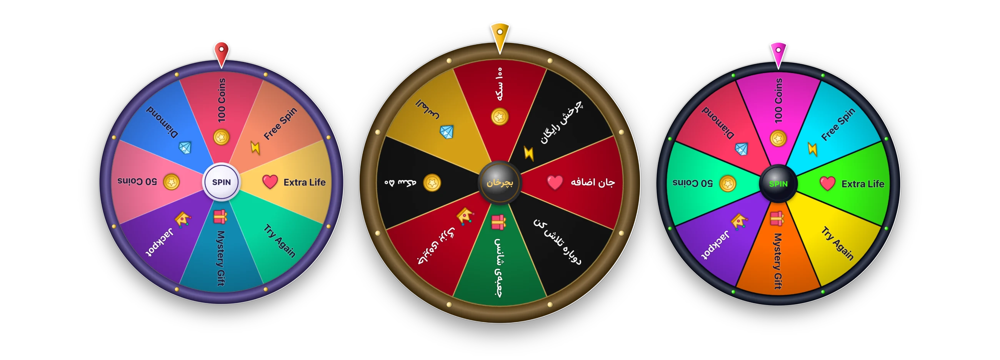

<div align="center">



# betterluck

**A physics-driven prize wheel for React.**<br />
Fair odds, real momentum, fully themable, and right-to-left ready.

[](https://www.npmjs.com/package/betterluck) [](https://github.com/alirezahematidev/betterluck/actions/workflows/ci.yml) [](LICENSE)

[**Live demo & playground**](https://alirezahematidev.github.io/betterluck/) · [Documentation](packages/betterluck/README.md)

</div>

## Highlights

- **Real physics.** Torque spins the wheel up, then it coasts against friction and drag. A spring-loaded flapper ticks over the pegs, and players can grab the wheel and flick it.
- **Fair, or your call.** Results are weighted random by default, or you can pass the result your server picked. The motion is solved to stop exactly there.
- **Labels that always fit.** Images and titles never overlap or overflow, at any size.
- **Persian and RTL.** Direction is detected per label, with correct letter joining, digit order and truncation.
- **Themable to the bone.** Style the frame, pegs, indicator, hub and labels through props, classes or CSS variables.
- **Small and dependable.** No dependencies, about 20 kB gzipped. Works with React 18 and 19, and renders on the server.

## Get started

```sh
npm install betterluck
```

```tsx
import { FortuneWheel } from "betterluck";

const segments = [
  { title: "100 Coins", frequency: 20, color: "#ef476f" },
  { title: "Try Again", frequency: 60, color: "#06d6a0" },
  { title: "Jackpot", frequency: 1, color: "#7b2cbf" },
];

export function Prize() {
  return (
    <FortuneWheel
      segments={segments}
      size={420}
      onSpinEnd={({ segment }) => alert(`You landed on ${segment.title}`)}
    />
  );
}
```

Click the hub or flick the wheel to spin it. To spin from your own button, use the ref.

**→ [Read the full documentation](packages/betterluck/README.md)**: recipes, the complete API, theming, and how the physics works.

## Repository

| Path                                         | What it is                                                                                                                                   |
| -------------------------------------------- | -------------------------------------------------------------------------------------------------------------------------------------------- |
| [`packages/betterluck`](packages/betterluck) | The library (the `betterluck` npm package).                                                                                                  |
| [`apps/demo`](apps/demo)                     | The [playground](https://alirezahematidev.github.io/betterluck/) in English and Persian. It covers every option and generates matching code. |

## Development

You need Node 20.19+ (see `.nvmrc`) and pnpm (pinned in `package.json`).

```sh
pnpm install
pnpm dev        # playground at http://localhost:5173, hot-reloading the library from source
```

| Command       | What it does                                                    |
| ------------- | --------------------------------------------------------------- |
| `pnpm check`  | Format check, lint, type-check and tests. This is what CI runs. |
| `pnpm test`   | Unit tests (Vitest).                                            |
| `pnpm lint`   | Lint with oxlint. `pnpm lint:fix` applies fixes.                |
| `pnpm format` | Format with oxfmt.                                              |
| `pnpm build`  | Build the library (tsdown) and the playground (Vite).           |

Commits follow [Conventional Commits](https://www.conventionalcommits.org/) (`feat:`, `fix:`, `docs:`, …), because the changelog is generated from them.

## Releasing

Releases use [release-it](https://github.com/release-it/release-it). A release runs the checks, bumps the version, updates `CHANGELOG.md`, tags `vX.Y.Z`, creates a GitHub release, and publishes to npm.

```sh
pnpm release --dry-run        # preview
pnpm release minor            # e.g. 0.0.0 → 0.1.0
```

To release from your machine, run `npm login` once, set `GITHUB_TOKEN` (for example `export GITHUB_TOKEN=$(gh auth token)`), and run the command from a clean `main` branch.

To release from GitHub instead, run the **Release** workflow and pick the increment. It publishes with npm provenance, using either [trusted publishing](https://docs.npmjs.com/trusted-publishers) (recommended: register this repository's `release.yml` for the package on npmjs.com) or an `NPM_TOKEN` secret.

Every push to `main` redeploys the playground to GitHub Pages.

## License

[MIT](LICENSE)
