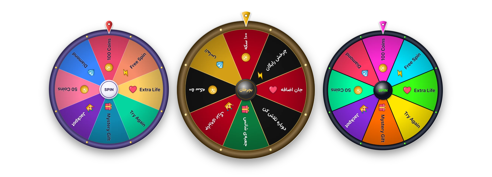

<div align="center">



# betterluck

**A physics-driven prize wheel for React.**<br />
Fair odds, real momentum, fully themable, and right-to-left ready.

[](https://www.npmjs.com/package/betterluck) [](https://github.com/alirezahematidev/betterluck/actions/workflows/ci.yml) [](https://github.com/alirezahematidev/betterluck/blob/main/LICENSE)

[**Live demo & playground**](https://alirezahematidev.github.io/betterluck/) · [Quick start](#quick-start) · [Recipes](#recipes) · [API](#api)

</div>

## Why betterluck

- **Real physics.** The wheel spins up under torque, then coasts against friction and air drag. A spring-loaded flapper ticks over the pegs as they pass. Players can also grab the wheel and flick it.
- **Fair, or your call.** Results are weighted by `frequency` using `crypto.getRandomValues`, or you can pass the result your server picked. Either way, the motion is solved so the wheel stops exactly there. Nothing snaps into place at the end.
- **Labels that always fit.** Each slice shows its image and title side by side, at any wheel size. Labels never overlap and never overflow their slice, and nothing is drawn below a readable size.
- **Persian and RTL.** Text direction is detected per label, letters join and digits order correctly, and long titles are cut without splitting a letter.
- **Themable to the bone.** Style the frame, pegs, indicator (or draw your own), hub and labels through props, `className`/`style`, per-part `classNames`/`styles`, or CSS variables.
- **Small and dependable.** No dependencies, about 20 kB gzipped. It works with React 18 and 19, renders on the server, and the hub is a real, keyboard-accessible button.

## Install

```sh
npm install betterluck
# or
pnpm add betterluck
# or
yarn add betterluck
```

Requires React 18.2 or newer. The package is ESM-only and needs no CSS import: its styles ship inside the component.

## Quick start

```tsx
import { useRef } from "react";
import { FortuneWheel, type FortuneWheelHandle, type Segment } from "betterluck";

const segments: Segment[] = [
  { title: "100 Coins", frequency: 20, color: "#ef476f", image: "/coin.svg" },
  { title: "Try Again", frequency: 60, color: "#06d6a0" },
  { title: "Jackpot", frequency: 1, color: "#7b2cbf", image: "/crown.svg" },
];

export function Prize() {
  const wheel = useRef<FortuneWheelHandle>(null);

  return (
    <>
      <FortuneWheel
        ref={wheel}
        segments={segments}
        size={420}
        onSpinEnd={({ segment }) => alert(`You landed on ${segment.title}`)}
      />
      <button onClick={() => wheel.current?.spin()}>Spin</button>
    </>
  );
}
```

Players can spin by clicking the hub, by flicking the wheel, or through your own button via the ref.

## Recipes

### Let your server pick the result

```tsx
const { index } = await fetch("/api/spin", { method: "POST" }).then((r) => r.json());
wheel.current?.spin({ index });
```

`onSpinStart` fires right away with the result the wheel **will** land on. `onSpinEnd` fires when it comes to rest.

### Persian and right-to-left

```tsx
<FortuneWheel
  segments={[
    { title: "۱۰۰ سکه", frequency: 3, color: "#ef476f" },
    { title: "جایزه‌ی بزرگ", frequency: 1, color: "#7b2cbf" },
  ]}
  hub={{ label: "بچرخان", ariaLabel: "چرخاندن گردونه" }}
  announce={({ segment }) => `نتیجه: ${segment.title}`}
  style={{ fontFamily: "Vazirmatn, sans-serif" }}
/>
```

Each label's direction comes from its first strong character, so mixed text like `100 سکه` reads correctly. To force a direction, set `labels={{ direction: "rtl" }}`. Text is measured in the font it actually renders with, including fonts from your own CSS, and it's re-measured when web fonts finish loading.

### Size

```tsx
// A diameter in pixels
<FortuneWheel segments={segments} size={320} />

// Any CSS length
<FortuneWheel segments={segments} size="min(90vw, 480px)" />

// No size: fills the width of its container
<FortuneWheel segments={segments} />
```

The wheel never grows wider than its container. Labels adapt to the size it actually renders at: text never goes below `labels.minFontPx` (9px). On a small wheel, long titles are shortened first, then hidden.

### Make what you see the real odds

```tsx
<FortuneWheel segments={segments} sizing="proportional" />
```

With the default `sizing="equal"`, every slice is the same size and `frequency` only changes the odds. With `"proportional"`, slice size follows `frequency`. In that mode, a segment with `frequency: 0` gets no slice at all.

### Theme it

```tsx
<FortuneWheel
  segments={segments}
  frame={{ width: 30, color: "#6b4a12", pegColor: "#ffe08a", dividerColor: "#e9c46a" }}
  indicator={{ position: "right", shape: "triangle", color: "#f5b700", size: 1.3 }}
  hub={{ label: "GO", color: "#222", textColor: "#ffd166" }}
  labels={{ color: "#fff" }}
  className="my-wheel"
/>
```

```css
.my-wheel {
  font-family: "Nunito", sans-serif;
  --bl-label-weight: 800;
  --bl-shadow: none;
}
```

The built-in styles have zero specificity, so any class you add wins without `!important`.

### Draw your own indicator

```tsx
<FortuneWheel
  segments={segments}
  indicator={{
    render: ({ tip }) => <path d={`M-12 -6 L12 -6 L0 ${tip} Z`} fill="gold" stroke="#000" />,
  }}
/>
```

The indicator is drawn in its own frame. Its hinge is at the origin, and it points down (+y) toward the wheel, with its tip `tip` units below the hinge. Pegs still push it around unless you set `flap: false`.

## API

### `<FortuneWheel>`

| Prop                   | Type                                | Default       | Description                                                                           |
| ---------------------- | ----------------------------------- | ------------- | ------------------------------------------------------------------------------------- |
| `segments`             | `Segment[]`                         | required      | The slices, in clockwise order.                                                       |
| `size`                 | `number \| string`                  | fill width    | Wheel diameter, in pixels or any CSS length.                                          |
| `sizing`               | `"equal" \| "proportional"`         | `"equal"`     | Slice sizes: [equal, or proportional to frequency](#make-what-you-see-the-real-odds). |
| `spinDirection`        | `"clockwise" \| "counterclockwise"` | `"clockwise"` | Direction of `spin()`. Flicks go whichever way they're thrown.                        |
| `physics`              | `Partial<WheelPhysics>`             |               | [Physics](#physics).                                                                  |
| `frame`                | `FrameOptions`                      |               | [Frame](#frame).                                                                      |
| `indicator`            | `IndicatorOptions`                  |               | [Indicator](#indicator).                                                              |
| `hub`                  | `HubOptions`                        |               | [Hub](#hub).                                                                          |
| `labels`               | `LabelOptions`                      |               | [Labels](#labels).                                                                    |
| `sound`                | `boolean`                           | `true`        | Synthesized peg ticks (Web Audio, no files).                                          |
| `allowFlick`           | `boolean`                           | `true`        | Grab and flick the wheel to spin it.                                                  |
| `disabled`             | `boolean`                           | `false`       | Blocks the hub, flicks and `spin()`.                                                  |
| `className`, `style`   |                                     |               | Applied to the root element.                                                          |
| `classNames`, `styles` | `WheelClassNames`, `WheelStyles`    |               | Class names or inline styles for [individual parts](#styling).                        |
| `aria-label`           | `string`                            |               | Accessible name of the wheel.                                                         |
| `announce`             | `false \| (result) => string`       | the title     | What screen readers hear when a spin ends.                                            |
| `nonce`                | `string`                            |               | Nonce for the built-in `<style>` tag under a strict Content-Security-Policy.          |
| `onSpinStart`          | `(result: SpinResult) => void`      |               | Fires at launch with the result it **will** land on.                                  |
| `onSpinEnd`            | `(result: SpinResult) => void`      |               | Fires when the wheel comes to rest.                                                   |
| `onTick`               | `() => void`                        |               | Fires as each peg passes the indicator, e.g. for haptics or custom sounds.            |

`SpinResult` is `{ index: number; segment: Segment }`.

### `Segment`

| Field       | Type                | Description                                                                   |
| ----------- | ------------------- | ----------------------------------------------------------------------------- |
| `title`     | `string`            | Text on the slice.                                                            |
| `frequency` | `number`            | Relative weight. `0` never wins.                                              |
| `color`     | `string`            | Slice fill. Hex, `rgb()` and `hsl()` colors also pick a readable label color. |
| `textColor` | `string?`           | Label color for this slice.                                                   |
| `image`     | `string?`           | Image URL or data URL, drawn beside the title, toward the center.             |
| `id`        | `string \| number?` | Your own identifier, returned in results. The wheel doesn't use it.           |

### Ref

| Method           | Description                                                                                                                    |
| ---------------- | ------------------------------------------------------------------------------------------------------------------------------ |
| `spin(options?)` | Starts a spin and returns `false` if the wheel is busy, disabled, or nothing can win. `spin({ index })` lands on that segment. |
| `isSpinning()`   | Whether a spin is in progress.                                                                                                 |

If `segments`, `sizing` or `indicator.position` change during a spin, the change takes effect once the spin settles. That way the wheel always stops on the slice it reported.

### Options

Lengths are in **wheel units**: the wheel is 500 units across and scales to its rendered size.

#### Frame

| Option         | Default | Description                                          |
| -------------- | ------- | ---------------------------------------------------- |
| `width`        | `24`    | Rim thickness. `0` removes the rim.                  |
| `color`        |         | Rim color (shaded automatically).                    |
| `pegs`         | `true`  | Pegs that push the indicator.                        |
| `pegColor`     |         | Peg color.                                           |
| `pegSize`      | `4.5`   | Peg radius. Shrinks automatically on crowded wheels. |
| `dividerColor` |         | Lines between slices.                                |
| `dividerWidth` | `1.5`   | `0` removes the lines.                               |
| `shading`      | `true`  | Soft shading toward the rim.                         |

#### Indicator

| Option     | Default | Description                                                                     |
| ---------- | ------- | ------------------------------------------------------------------------------- |
| `position` | `"top"` | `"top"`, `"right"`, `"bottom"`, `"left"`, or degrees clockwise from 12 o'clock. |
| `shape`    | `"pin"` | `"pin"`, `"triangle"` or `"needle"`.                                            |
| `color`    |         | Body color (shaded automatically).                                              |
| `size`     | `1`     | Scale. The indicator's physical arm scales with it.                             |
| `flap`     | `true`  | Let pegs push it. With `false` it holds still but still ticks.                  |
| `render`   |         | `({ tip, scale }) => ReactNode` to [draw your own](#draw-your-own-indicator).   |

#### Hub

| Option      | Default  | Description                                                                      |
| ----------- | -------- | -------------------------------------------------------------------------------- |
| `label`     | `"SPIN"` | Text is fitted to the hub. Any other React node, such as an icon, renders as-is. |
| `radius`    | `40`     | `0` hides the hub.                                                               |
| `color`     |          | Face color.                                                                      |
| `textColor` |          | Label color.                                                                     |
| `clickable` | `true`   | Clicking the hub spins.                                                          |
| `ariaLabel` |          | Accessible name of the hub button. Defaults to the label text.                   |

#### Labels

| Option         | Default  | Description                                                                |
| -------------- | -------- | -------------------------------------------------------------------------- |
| `color`        | auto     | One color for every label. By default each slice gets a contrasting color. |
| `direction`    | `"auto"` | `"auto"` (detected per label), `"ltr"` or `"rtl"`.                         |
| `maxFontSize`  | `24`     | Largest font size, in wheel units.                                         |
| `minFontPx`    | `9`      | Readability floor, in CSS pixels.                                          |
| `minImagePx`   | `12`     | Smallest image, in CSS pixels.                                             |
| `imageScale`   | `1.9`    | Image size relative to the font size.                                      |
| `maxImageSize` | `52`     | Largest image, in wheel units.                                             |
| `uniform`      | `true`   | One font size shared by all labels.                                        |
| `inset`        | `12`     | Gap between the labels and the rim.                                        |

#### Physics

| Option           | Default | Unit   | Description                                                |
| ---------------- | ------- | ------ | ---------------------------------------------------------- |
| `minLaunchSpeed` | `15`    | rad/s  | Slowest launch speed for `spin()`.                         |
| `maxLaunchSpeed` | `22`    | rad/s  | Fastest launch speed for `spin()`.                         |
| `spinUpTime`     | `0.45`  | s      | How long the launch torque pushes the wheel.               |
| `friction`       | `0.9`   | rad/s² | Axle friction. Shapes the slow final crawl.                |
| `drag`           | `0.32`  | 1/s    | Air drag. Bleeds energy while the wheel is fast.           |
| `flickThreshold` | `4`     | rad/s  | Release speed a flick needs to count as a spin. Minimum 2. |

With the defaults, a spin lasts about 6.8 s and makes 7 turns. `estimateSpin(physics)` returns both figures, which helps while tuning.

### Styling

The built-in styles are wrapped in `:where()`, so they have zero specificity and any class you pass wins. Colors flow through CSS variables, which the color props set too:

| Variable                                             | Controls                                         |
| ---------------------------------------------------- | ------------------------------------------------ |
| `--bl-font`                                          | Label and hub font family                        |
| `--bl-label-color`                                   | Every label (default: automatic contrast)        |
| `--bl-label-light`, `--bl-label-dark`                | The two automatic label colors                   |
| `--bl-label-weight`                                  | Label weight (`700`)                             |
| `--bl-label-halo`                                    | Outline around labels (`transparent` removes it) |
| `--bl-frame-color`                                   | Rim                                              |
| `--bl-peg-color`                                     | Pegs                                             |
| `--bl-divider-color`, `--bl-divider-width`           | Lines between slices                             |
| `--bl-hub-color`, `--bl-hub-accent`, `--bl-hub-text` | Hub                                              |
| `--bl-indicator-color`, `--bl-indicator-stroke`      | Indicator                                        |
| `--bl-winner-color`                                  | Highlight on the winning slice                   |
| `--bl-shadow`                                        | Drop shadow under the wheel                      |
| `--bl-focus`                                         | Hub focus ring                                   |

You can target these parts with `classNames` or `styles`: `root`, `disc`, `slice`, `label`, `image`, `frame`, `peg`, `winner`, `hub`, `hubLabel` and `indicator`. While a spin runs, the root element has `data-spinning`. When the wheel is disabled, it has `data-disabled`.

Label and hub font **sizes** are fitted to the wheel and set inline, so no stylesheet can make them overflow. Everything else about the text (family, weight, letter spacing, color) is yours to style, and the wheel measures text with whatever you choose.

### Utilities

| Export                                                                                   | Description                                                  |
| ---------------------------------------------------------------------------------------- | ------------------------------------------------------------ |
| `estimateSpin(physics)`                                                                  | `{ seconds, turns }` for an average spin.                    |
| `probabilities(segments)`                                                                | Each segment's chance of winning, from 0 to 1.               |
| `totalWeight(segments)`                                                                  | Sum of all positive frequencies.                             |
| `detectDirection(text)`                                                                  | `"ltr"`, `"rtl"` or `null`, from the first strong character. |
| `resolvePhysics(partial)`                                                                | Fills in defaults and clamps physics values to safe ranges.  |
| `DEFAULT_PHYSICS`, `DEFAULT_FRAME`, `DEFAULT_INDICATOR`, `DEFAULT_HUB`, `DEFAULT_LABELS` | The defaults listed above.                                   |

Every type used above is exported as well: `Segment`, `SpinResult`, `FortuneWheelHandle`, `FortuneWheelProps`, `WheelPhysics`, `FrameOptions`, `IndicatorOptions`, `HubOptions`, `LabelOptions` and more.

## How it works

**The result is chosen first, and the motion is solved to land there.** A resting point inside the winning slice, away from its edges, is picked at random. The spin is then planned to stop exactly on it.

A spin starts with a constant torque that spins the wheel up. Then it coasts under `dω/dt = −μ − k·ω`: axle friction `μ` plus air drag `k·ω`. That equation has a closed-form solution, so every frame reads the exact position, with no drift and no dependence on frame rate. The launch speed is solved so the coast ends on the target. A flick keeps the speed the player gave it. Instead, both friction terms are scaled by one factor, which replays the same deceleration curve slightly faster or slower.

The indicator is a damped spring hinge. Pegs are solid: each one pushes the flapper until it slips past, then the flapper snaps back with a tick. The wheel itself is drawn once and turned on the GPU, so a spin doesn't re-render React.

## Compatibility

- **React** 18.2+ and 19.
- **Server rendering** works: the markup and styles render on the server. The bundle starts with `"use client"`, as React Server Components frameworks such as the Next.js App Router require.
- **Browsers:** evergreen versions (Chrome/Edge 111+, Firefox 121+, Safari 16.4+).
- **Content-Security-Policy:** pass `nonce` to allow the built-in `<style>` tag.

## Contributing

Issues and pull requests are welcome. Development setup, scripts and the release process are described in the [repository README](https://github.com/alirezahematidev/betterluck#development).

## License

[MIT](https://github.com/alirezahematidev/betterluck/blob/main/LICENSE)
